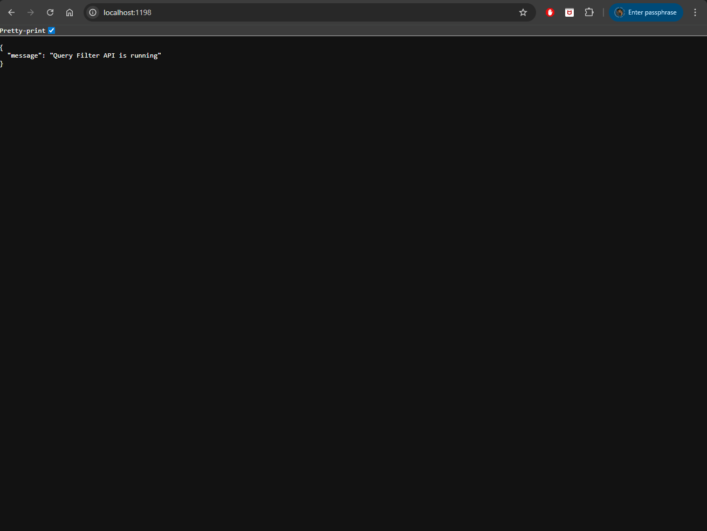
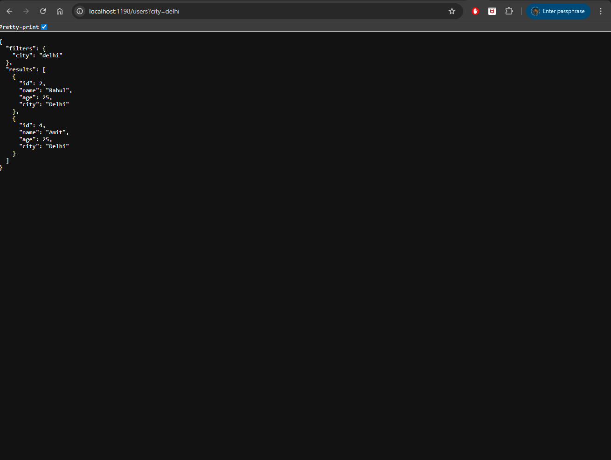
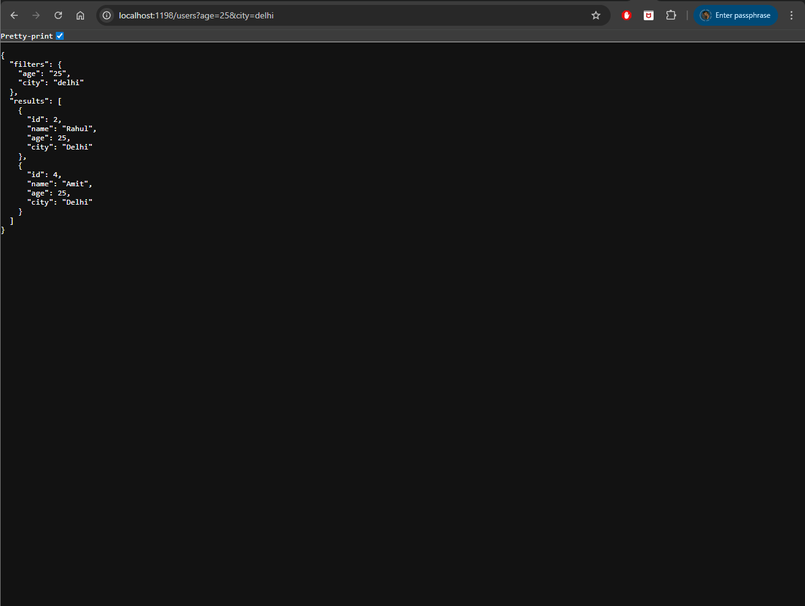

# express-project-04-query-filter-api

A simple Express.js backend API that demonstrates filtering results using query parameters.

## Project Goal

This project demonstrates how to use query parameters in Express.js to filter API responses.

Example queries:

- `/users?age=25`
- `/users?city=delhi`
- `/users?age=25&city=delhi`

## Tech Stack

- Node.js
- Express.js
- Nodemon

## Project Structure

```
express-project-04-query-filter-api
│
├─ src
│  ├─ controllers
│  │  └─ user.controller.js
│  │
│  └─ routes
│     └─ user.routes.js
│
├─ index.js
├─ package.json
├─ package-lock.json
└─ .gitignore
```

## Installation

Clone the repository

```bash
git clone https://github.com/a2rp/express-project-04-query-filter-api.git
cd express-project-04-query-filter-api
```

Install dependencies

```bash
npm install
```

## Run the Project

Development mode

```bash
npm run dev
```

Server runs at

```
http://localhost:1198
```

## API Endpoint

### Get Users

```
GET /users
```

### Query Examples

Filter by age

```
/users?age=25
```

Filter by city

```
/users?city=delhi
```

Filter by multiple parameters

```
/users?age=25&city=delhi
```

## Example Response

```json
{
    "filters": {
        "age": "25"
    },
    "results": [
        {
            "id": 2,
            "name": "Rahul",
            "age": 25,
            "city": "Delhi"
        }
    ]
}
```

## Learning Outcome

By building this project you learn how to:

- read query parameters using `req.query`
- filter data on the server
- build dynamic API endpoints

## Author

Ashish Ranjan

---

Follow me

- GitHub: https://github.com/a2rp
- Portfolio: https://www.ashishranjan.net
- LinkedIn: https://www.linkedin.com/in/aashishranjan
- Facebook: https://www.facebook.com/theash.ashish/









## Links

- Portfolio: [https://www.ashishranjan.net](https://www.ashishranjan.net)
- GitHub: [https://github.com/a2rp](https://github.com/a2rp)
- CodePen: [https://codepen.io/ash1198](https://codepen.io/ash1198)
- LinkedIn: [https://www.linkedin.com/in/aashishranjan](https://www.linkedin.com/in/aashishranjan)
- Facebook: [https://www.facebook.com/theash.ashish/](https://www.facebook.com/theash.ashish/)
- YouTube: [https://www.youtube.com/@ashishranjan-ashz?sub_confirmation=1](https://www.youtube.com/@ashishranjan-ashz?sub_confirmation=1)
- Email: [ash.ranjan09@gmail.com](mailto:ash.ranjan09@gmail.com)

## Support

- Support: [https://a2rp-donation-page.netlify.app/](https://a2rp-donation-page.netlify.app/)
- Buy Me A Coffee: [https://buymeacoffee.com/a2rp](https://buymeacoffee.com/a2rp)
- Patreon: [https://patreon.com/a2rp](https://patreon.com/a2rp)